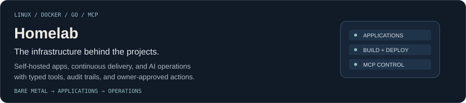
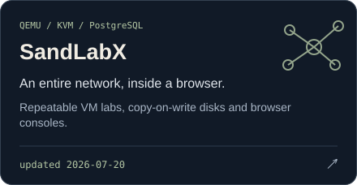

[Blog](https://blog.nakshatraneuratech.dev) · [LinkedIn](https://www.linkedin.com/in/nakshatra-kundlas-7a33a9170/) · [Email](mailto:ekagra7865@gmail.com) · [Open source](https://github.com/pulls?q=is%3Apr+author%3AZburgers+is%3Apublic)

I'm **Nakshatra**, a software engineer in Delhi. I build backend systems, desktop tools that keep your data on your machine, and AI experiments you can actually reproduce.

I like the whole journey: the interface, the database, the background job, and the machine keeping it alive at 2 a.m. Lately that means **Go operations tooling**, safer agent workflows, and turning a spare bare-metal server into a small application platform. Away from the serious bits: Minecraft mods, tiny games, and an unreasonable number of side projects.

## A small detour

Space / ↑ / tap to fly · classic or chill · your best score stays with you

## Things I've built

**Also building:** [CB Connect](https://github.com/Zburgers/cb-connect), a consent-first couples health app; and [Crip Wallet](https://github.com/Zburgers/crip-wallet), policy, budgets and approval controls for agents, currently tested with local mock assets.

[Explore all repositories ↗](https://github.com/Zburgers?tab=repositories)

## Beyond my own repos

I contribute to **OpenSRE, Pulse Analytics, REA, T3 Code, OpenCode Cursor, and the Codex model catalog**—from observability and privacy controls to parser safety and agent integrations.

| Project | Contribution | PR |
| --- | --- | --- |
| OpenSRE | Snowflake query evidence and file-sync transfer telemetry | [#5646](https://github.com/Tracer-Cloud/opensre/pull/5646) · [#4569](https://github.com/Tracer-Cloud/opensre/pull/4569) · Merged |
| Pulse Analytics | Granular Discord presence privacy controls | [#49](https://github.com/xt0n1-t3ch/Pulse-Analytics/pull/49) · Merged |
| REA | XML depth checks before recursive plist decoding | [#2161](https://github.com/morluto/rea/pull/2161) · Merged |
| T3 Code | Handling omitted Cursor subagent result fields | [#26520](https://github.com/pingdotgg/t3code/pull/26520) · Open |
| OpenCode Cursor | Migration to the stable plugin API | [#42](https://github.com/ephraimduncan/opencode-cursor/pull/42) · Open |
| Codex model catalog | GPT-6.1 Terra model metadata | [#93](https://github.com/router-for-me/models/pull/93) · Open |

[More contributions ↗](https://github.com/pulls?q=is%3Apr+author%3AZburgers+is%3Apublic)

I also maintain [Minecraft mod ports](https://github.com/Zburgers/more-big-trees)—because sometimes the important engineering problem is bigger trees.

## Notes from the workbench

**[Nakshatra NeuraTech ↗](https://blog.nakshatraneuratech.dev)**

My corner of the internet for experiments, build notes, and what I learn when software meets real use.

## In the commit history

<picture>
  <source media="(prefers-color-scheme: dark)" srcset="https://raw.githubusercontent.com/Zburgers/Zburgers/output/github-contribution-grid-snake-dark.svg">
  <source media="(prefers-color-scheme: light)" srcset="https://raw.githubusercontent.com/Zburgers/Zburgers/output/github-contribution-grid-snake.svg">
  
</picture>

