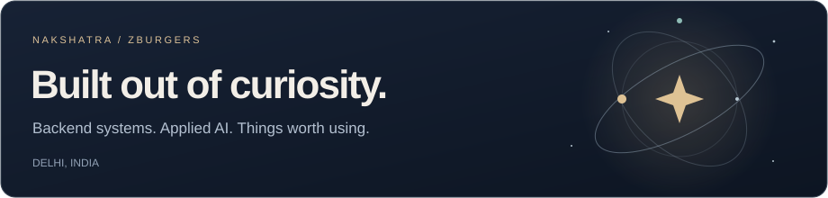
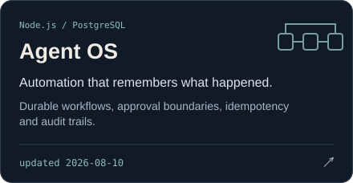
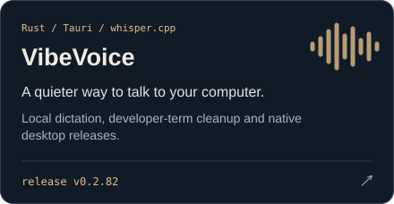
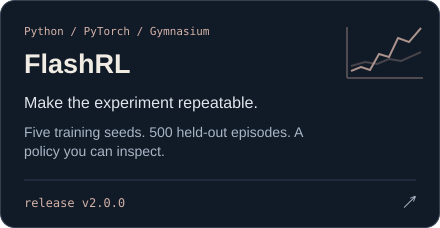
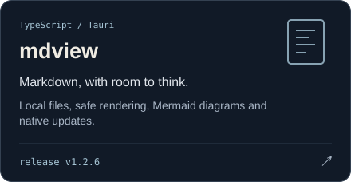
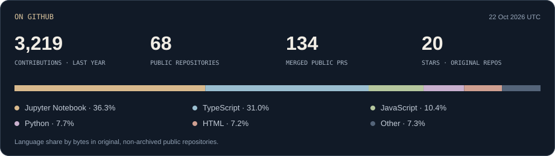

[GitHub projects](https://github.com/Zburgers?tab=repositories) · [Build notes](https://blog.nakshatraneuratech.dev) · [LinkedIn](https://www.linkedin.com/in/nakshatra-kundlas-7a33a9170/) · [Email](mailto:ekagra7865@gmail.com)

I'm **Nakshatra**, a software engineer in Delhi NCR. I build **AI applications, backend systems, and private desktop tools**—and run the infrastructure behind them.

My work spans document ingestion, execution-grounded analytics, background workers, and agent controls. I care about what happens after the happy path: a retry, a revoked permission, a model's wrong answer, or a worker that restarts halfway through.

**Current focus:** Go operations tooling with MCP, reliable AI workflows, and software that keeps working after the demo.

## Selected builds

- **[Agent OS](https://github.com/Zburgers/agent-os/blob/main/docs/CASE_STUDY_AUTOMATION_RELIABILITY.md)** — durable effect states, service-enforced approvals, and restart recovery. The case study documents 34 passing tests and reconciliation without replay.
- **[VibeVoice](https://github.com/Zburgers/vibevoice)** — local transcription on Windows, Linux and macOS; verified Windows engine/model downloads and opt-in, atomic transcript history.
- **[FlashRL](https://github.com/Zburgers/FlashRL/blob/master/reports/v2_benchmark_report.md)** — five training seeds, 120K frames each, 500 held-out evaluation episodes. Mean score **301.90 vs 126.18 for random**, with published uncertainty and run data.
- **[mdview](https://github.com/Zburgers/mdview)** — Markdown, diagrams and native releases, without turning a local document into a cloud upload.

Also building: [SandLabX](https://github.com/Zburgers/SandlabsX), a QEMU/KVM network lab platform, and [Crip Wallet](https://github.com/Zburgers/crip-wallet), policy and approval controls for agent spending.

## Beyond my own repos

**8 merged PRs across OpenSRE, Pulse Analytics and REA**, verified October 29, 2026. A few worth opening:

| Project | Contribution | Evidence |
| --- | --- | --- |
| OpenSRE | Turned Snowflake query history into citeable investigation evidence | [Merged #5646](https://github.com/Tracer-Cloud/opensre/pull/5646) |
| OpenSRE | Added transferred-byte telemetry to file-sync reports | [Merged #4569](https://github.com/Tracer-Cloud/opensre/pull/4569) |
| Pulse Analytics | Added granular Discord presence privacy controls | [Merged #49](https://github.com/xt0n1-t3ch/Pulse-Analytics/pull/49) |
| REA | Enforced XML nesting limits before recursive plist decoding | [Merged #2161](https://github.com/morluto/rea/pull/2161) |

**Recent submissions · open as of October 29:** [Cursor subagent result handling in T3 Code](https://github.com/pingdotgg/t3code/pull/26520), [OpenCode Cursor plugin API migration](https://github.com/ephraimduncan/opencode-cursor/pull/42), and [Codex model catalog metadata](https://github.com/router-for-me/models/pull/93).

[All public contributions ↗](https://github.com/pulls?q=is%3Apr+author%3AZburgers+is%3Apublic)

## What I use

**Backend:** Python · TypeScript · Go · PostgreSQL · Redis  
**AI applications:** LiteLLM · Pydantic AI · PyTorch · MCP  
**Interfaces:** React · Next.js · Rust / Tauri  
**Delivery:** Linux · Docker · GitHub Actions · pytest · Playwright

## In the commit history

Refreshed daily. Rolling-year contributions, public PRs and repository counts measure different things; they are not a productivity score.

<picture>
  <source media="(prefers-color-scheme: dark)" srcset="https://raw.githubusercontent.com/Zburgers/Zburgers/output/github-contribution-grid-snake-dark.svg">
  <source media="(prefers-color-scheme: light)" srcset="https://raw.githubusercontent.com/Zburgers/Zburgers/output/github-contribution-grid-snake.svg">
  
</picture>

## A small detour

Space / ↑ / tap to fly · classic or chill · your best score stays with you

I also maintain [Minecraft mod ports](https://github.com/Zburgers/more-big-trees). Sometimes the important engineering problem is bigger trees.

